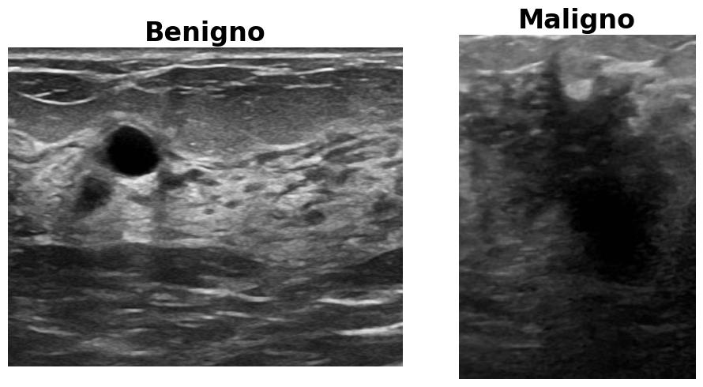
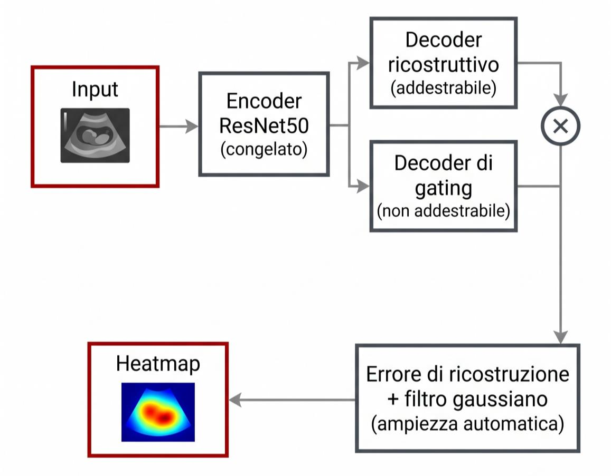
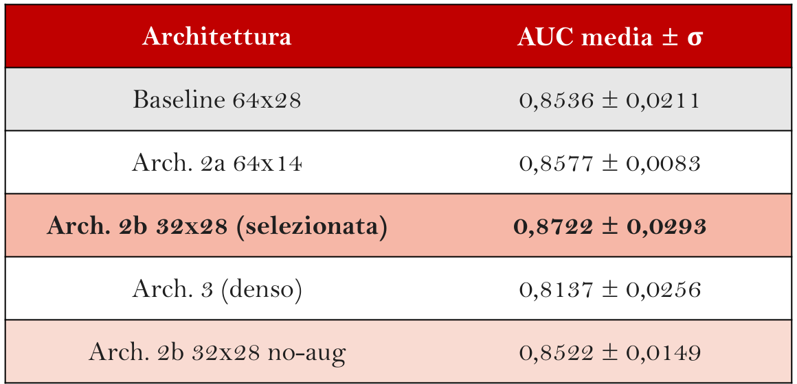
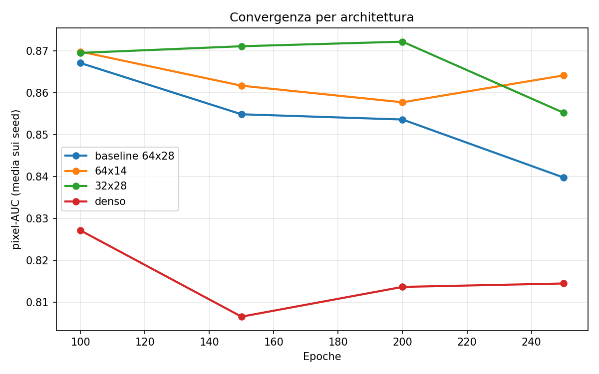
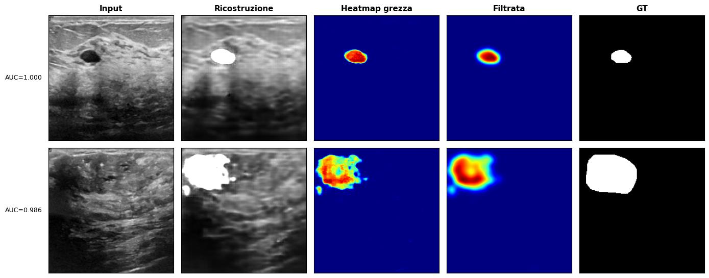
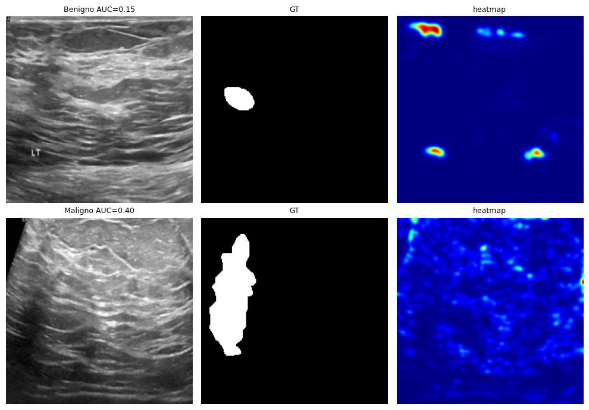
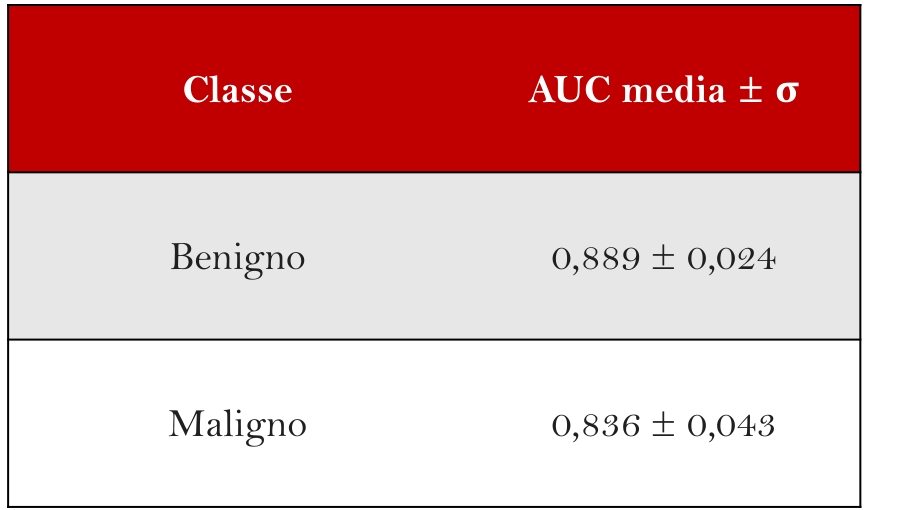
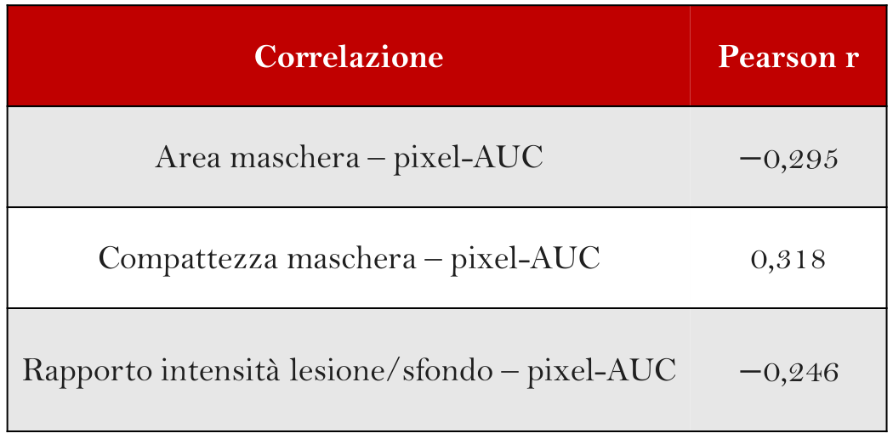

# Explainable Anomaly Detection for Breast Cancer Localization

<div align="center">

**Application and architectural study of AE-XAD on the BUSI (Breast Ultrasound Images) dataset**

[](https://www.python.org/)
[](https://pytorch.org/)
[-orange?style=flat)](https://doi.org/10.1016/j.array.2025.100537)
[](https://www.kaggle.com/datasets/aryashah2k/breast-ultrasound-images-dataset)

</div>

---

## 📌 Panoramica

Questo repository raccoglie il codice e gli esperimenti del mio lavoro di tesi di laurea triennale in Ingegneria Informatica. 

Il progetto riguarda la sperimentazione e l'adattamento dell'algoritmo **AE-XAD** (*Autoencoder for Explainable Anomaly Detection*) su immagini ecografiche mammarie in scala di grigi per la localizzazione di lesioni tumorali.

---

## 🖼️ Dataset BUSI (Breast Ultrasound Images)

La sperimentazione è condotta sul dataset pubblico **BUSI** (780 immagini ecografiche suddivise tra classi *normal*, *benign* e *malignant* con relative maschere binarie ground-truth).

<div align="center">
  
</div>

---

## 🏗️ Architettura: AE-XAD Grayscale

Il framework impiega un encoder ResNet50 preaddestrato con pesi congelati (adattato per input a singolo canale) e un decoder a doppio ramo (ricostruttivo addestrabile e gating moltiplicativo non addestrabile). La heatmap di anomalia viene generata a partire dall'errore di ricostruzione normalizzato, filtrato con kernel gaussiano ad ampiezza stimata automaticamente.

<div align="center">
  
</div>

---

## 📊 Risultati Sperimentali

Sono state progettate e confrontate quattro diverse topologie di *bottleneck* a risoluzione standard **224×224**, valutando le prestazioni su protocollo a **4 seed deterministici (101, 359, 461, 491)** in termini di **pixel-AUC media ± deviazione standard**:

<div align="center">
  
</div>

### Dinamica di Convergenza nel Tempo
Monitorando l'andamento da epoca 100 a 250, l'**Architettura 2b (32×28)** raggiunge il picco massimo di localizzazione a **200 epoche ($0{,}8722$)**, dimostrando come la conservazione della risoluzione spaziale rispetto alla compressione dei soli canali sia ottimale per compiti di localizzazione pixel-level.

<div align="center">
  
</div>

---

## 🔍 Analisi Qualitativa e Correlazioni Cliniche

L'analisi degli errori e del comportamento qualitativo è stata condotta sull'**Architettura 2b (32×28)** sul **seed 461** (il run con le prestazioni più elevate, con pixel-AUC media pari a $0{,}9103$), allo scopo di caratterizzare la risposta del modello nell'assetto sperimentale più favorevole.

### Casi di Localizzazione Ottimale
Nei casi con pixel-AUC prossima a $1{,}000$ (es. casi a $1{,}000$ e $0{,}986$), la heatmap converge con precisione su un'unica regione compatta che si sovrappone fedelmente alla maschera di ground truth della lesione, evidenziando come il meccanismo di gating e l'adattamento del kernel gaussiano isolino efficacemente l'anomalia in presenza di un gradiente di contrasto sufficiente.

<div align="center">
  
</div>

### Pattern di Errore Ricorrenti
Dall'ispezione dei 20 casi del test set con pixel-AUC più bassa emergono due modalità di fallimento prevalenti:
1. **Attivazione periferica ai bordi (più frequente):** La heatmap concentra l'errore di ricostruzione in regioni periferiche dell'immagine distanti dalla maschera reale, spesso in prossimità dei bordi ecografici. Il modello non fallisce tanto per una sovrastima dell'area tumorale, quanto per un'errata attribuzione della posizione spaziale.
2. **Attivazione diffusa e priva di struttura (meno frequente):** L'errore si distribuisce in modo debole e uniforme su tutto il parenchima, senza una focalizzazione riconoscibile.

<div align="center">
  
</div>

### Confronto di Performance per Classe (Benigno vs Maligno)
Il modello manifesta un divario sistematico significativo tra le due patologie:
* **Benigno:** $\text{AUC} = 0{,}8889 \pm 0{,}0236$
* **Maligno:** $\text{AUC} = 0{,}8364 \pm 0{,}0429$

La classe clinicamente più critica (maligno) risulta più ostica da localizzare a causa delle sue proprietà morfologiche intrinseche: forme irregolari con margini spicolati, ecogenicità ridotta e ombre acustiche posteriori, che deviano maggiormente rispetto alla regolarità delle lesioni benigne (tipicamente ovali e a contorni netti).

<div align="center">
  
</div>

### Correlazioni Morfologiche di Pearson ($n=627$, Seed 461)
Per verificare se le caratteristiche geometriche e visive delle lesioni influiscano sistematicamente sulla qualità della localizzazione, sono stati calcolati i coefficienti di correlazione di Pearson ($r$) su tutte le 627 immagini anomale del test set:
* **Area della maschera ($r = -0{,}295$):** Correlazione negativa debole-moderata. All'aumentare dell'estensione superficiale della lesione la pixel-AUC tende a diminuire: le lesioni più ampie presentano eterogeneità tissutali interne più complesse da ricostruire.
* **Compattezza ($4\pi \cdot \text{area}/\text{perimetro}^2$, $r = +0{,}318$):** Correlazione positiva debole-moderata (pari a 1 per un cerchio perfetto, tendente a 0 per forme irregolari/allungate). Lesioni con bordi frastagliati o spicolati sono associate a una localizzazione meno accurata (effetto particolarmente marcato nei benigni, $r = 0{,}382$).
* **Rapporto di contrasto lesione/sfondo ($r = -0{,}246$):** Rapporto tra l'intensità media interna ed esterna alla maschera. Le lesioni isoecogene (con intensità luminosa molto simile al parenchima circostante) presentano un basso contrasto visivo che ostacola la discriminazione da parte dell'autoencoder.

<div align="center">
  
</div>

---

## 📁 Struttura della Repository

```
├── README.md                       # Documentazione del progetto
├── requirements.txt                # Dipendenze Python e pin di compatibilità
├── testDataset.py                  # Script di verifica integrità dataset
├── testPrepared.py                 # Script di verifica preprocessing
│
├── assets/                         # Figure e grafici dei risultati (ritagliati)
│   ├── benigno_vs_maligno.png
│   ├── architettura_aexad.png
│   ├── tabella_risultati.png
│   ├── convergenza_plot.png
│   ├── heatmap_successo.png
│   ├── heatmap_errori.png
│   ├── tabella_classi.png
│   └── tabella_correlazioni.png
│
├── experiments/                    # Notebook riproducibili (224x224)
│   ├── 01_baseline_64x28.ipynb         # Baseline AE-XAD (64x28)
│   ├── 02_arch_64x14.ipynb            # Architettura 2a (64x14)
│   ├── 03_arch_32x28_selected.ipynb   # Architettura 2b (32x28, migliore configurazione)
│   ├── 03b_arch_32x28_noAug.ipynb     # Architettura 2b (32x28) senza data augmentation
│   ├── 04_arch_dense.ipynb            # Architettura 3 con bottleneck fully-connected
│   └── 05_convergence_analysis.ipynb  # Studio di convergenza temporale (100-250 epoche)
│
└── repo/                           # Codice sorgente AE-XAD con adattamenti grayscale
    └── AE-XAD-main/
        ├── dataloaders/            # Dataloader custom e data augmentation
        ├── models/                 # Architetture neurali encoder/decoder
        ├── tools/                  # Funzioni di utilità e metriche
        └── trainer/                # Routine di addestramento e validazione
```

---

## 🚀 Setup e Riproducibilità

### 1. Clonazione del Repository
```bash
git clone https://github.com/mariocostabile/AE-XAD-BUSI.git
cd AE-XAD-BUSI
```

### 2. Ambiente Virtuale
```bash
python -m venv venv

# Windows (PowerShell)
.\venv\Scripts\Activate.ps1

# Linux / macOS
source venv/bin/activate
```

### 3. Installazione Dipendenze
```bash
pip install --upgrade pip
pip install -r requirements.txt
```

> **Nota:** `albumentations==1.3.1` e `numpy<2.0.0` sono requisiti obbligatori per garantire la compatibilità con i moduli di data augmentation di AE-XAD.

### 4. Esecuzione
Avviare Jupyter ed eseguire i notebook nella cartella `experiments/`:
```bash
jupyter lab
```

---

## 📚 Riferimenti Bibliografici

### AE-XAD
* **Repository Originale:** [simona-nistico/AE-XAD_repo](https://github.com/simona-nistico/AE-XAD_repo)
* **Articolo Scientifico:**
  ```bibtex
  @article{angiulli2025explaining,
    title={Explaining anomalies through semi-supervised Autoencoders},
    author={Angiulli, Fabrizio and Fassetti, Fabio and Ferragina, Luca and Nistic{\`o}, Simona},
    journal={Array},
    volume={28},
    pages={100537},
    year={2025},
    publisher={Elsevier},
    doi={10.1016/j.array.2025.100537}
  }
  ```

### BUSI Dataset
* **Articolo Scientifico:**
  ```bibtex
  @article{al2020dataset,
    title={Dataset of breast ultrasound images},
    author={Al-Dhabyani, Walid and Gomaa, Mostafa and Khaled, Hussien and Fahmy, Aly},
    journal={Data in Brief},
    volume={28},
    pages={104863},
    year={2020},
    publisher={Elsevier}
  }
  ```
